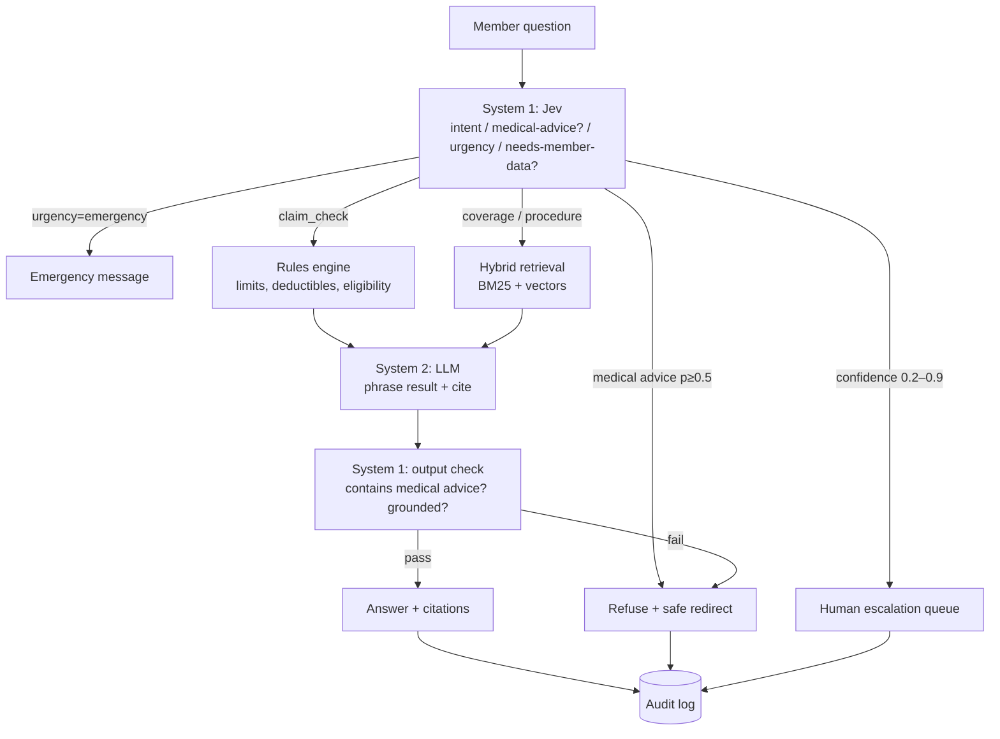

# MASTER PROMPT — BenefitPilot

> Paste this whole file into Claude Code at the root of an empty repo (or save it as `CLAUDE.md` so every session reads it).

---

## 0. Who I am and how to work with me

I'm Yasaswin, a Toronto-based data/AI engineer. I'm building this as a portfolio project for **League** (a Toronto healthcare-AI platform that serves health plans and insurers). I'll be asked about every design choice in interviews, so:

- **Explain the "why" behind each architecture and code decision** as you build it, not just the "what". Keep a running `docs/DECISIONS.md` in ADR style: decision, alternatives considered, why this one, trade-offs.
- **Work in phases (section 9).** At the end of each phase, stop, summarize what was built, show how to run it, and wait for my go-ahead before starting the next one.
- Write tests alongside the code, not afterwards.
- **Never invent APIs.** If you're unsure of an external API (especially Jev's), read its docs or ask me. Don't guess request or response shapes.
- **Never commit secrets.** Keep keys in `.env`, add `.env.example`, and make sure `.gitignore` covers them.
- Prefer small, readable modules over clever abstractions.

---

## 1. What we're building

**BenefitPilot** is an AI assistant for **health-insurance plan members**. It answers questions about **coverage and benefits** and flags **plan-rule violations** in claims, using **synthetic data only**.

Example interactions:
- "Is physiotherapy covered under my plan?" → grounded answer citing the plan section.
- "I've used $420 of physio this year. Will a $120 session be covered?" → **violation check**: "This exceeds your $500 annual physio maximum by $40. $80 would be covered."
- "My chest hurts, what medication should I take?" → **guardrail**: politely refuses to give medical advice and points to a clinician or emergency services.
- "How do I submit a claim for dental?" → procedural answer from the plan.

**Core idea: System 1 vs System 2** (from *Thinking, Fast and Slow*):
- **System 1 = Jev** (TypeSafe). It's a fast, calibrated decision model that returns *probabilities* for typed questions instead of generating text. It handles routing, guardrails and urgency in a single parallel pass.
- **System 2 = LLM + RAG.** It's slow and deliberate, and only runs when a written, grounded answer is actually needed.
- **Deterministic code = the rules engine.** All arithmetic and limit checks happen in plain Python, never in a model.

Pipeline: **Jev → (rules engine | LLM+RAG | refuse | human escalation) → Jev output check.**

---

## 2. Non-negotiables

1. **Synthetic data only.** No real people, no real PHI. Say so in the README and in a footer in the UI.
2. **No medical advice, ever.** The assistant can say what a plan covers. It can never say what's clinically right for someone. The guardrail must be tested, and CI must fail if it regresses.
3. **Every answer must be grounded.** Coverage answers cite plan section IDs. If retrieval finds nothing relevant, say "I couldn't find that in your plan" instead of guessing.
4. **Money is computed by code.** The LLM may phrase the result, but the numbers come from the rules engine.
5. **Everything is auditable.** Log every request with its route decision, the Jev probabilities, the retrieved chunks, the rules-engine result, the final answer, latency and cost. (In healthcare, traceability matters as much as accuracy.)
6. **The project must run without a Jev key.** Build a `FallbackRouter` behind the same interface. CI runs on the fallback (and on mocked Jev responses), so it never needs paid keys or network access.

---

## 3. Tech stack (and why)

| Layer | Choice | Why |
|---|---|---|
| Language | Python 3.11+ | My strongest language, and the AI ecosystem is built around it |
| API | **FastAPI** (async) | Typed with Pydantic, auto-generated OpenAPI docs, and I already use it |
| Orchestration | **LangGraph** | Explicit state machine for routing and escalation; I've used it in my Groot project |
| System 1 | **Jev** via the official Python SDK (`pip install typesafe-sdk`, key in `TYPESAFE_API_KEY`), **pinned to `jev-1.13.0`** (not `jev-latest`). Use retries with exponential backoff, since rate limits aren't published | Calibrated probabilities, sub-second, very cheap. Pinning keeps eval results reproducible |
| System 1 (comparison, optional) | **Cloudflare Clef / Clef-flash** on Workers AI (open weights, Jev-API compatible) | Adds a third router to the benchmark: proprietary Jev vs open-weight Clef |
| System 1 fallback | Small classifier (TF-IDF + logistic regression, or an LLM limited to fixed options) | Lets the project run without Jev, and gives a baseline to compare against |
| System 2 | Provider-agnostic LLM client (Anthropic / OpenAI / local Ollama) | Avoids vendor lock-in, and Ollama gives a free local option |
| Retrieval | **Hybrid search**: BM25 + vector embeddings (Chroma or pgvector), sentence-transformers embeddings | Plan documents are full of exact terms ("orthotics", "paramedical"), so BM25 catches those and vectors catch paraphrases |
| Rules engine | Plan rules in YAML, evaluated in pure Python | Deterministic, testable, and easy for non-engineers to read |
| Data | SQLite (members, claims, usage) + Markdown plan documents | Zero setup; can swap to Postgres later |
| UI | **Streamlit** for the MVP (stretch goal: React) | Fastest way to a demo. League's apps team uses React, so a React front end is a good stretch goal |
| Testing | pytest, plus an eval harness | |
| CI | GitHub Actions: lint, tests, guardrail red-team suite, small eval | Shows engineering discipline |
| Packaging | Docker + docker-compose | One command to run |

Record any deviation from this table in `DECISIONS.md`.

---

## 4. Architecture

Put this diagram in the README as Mermaid:



### Jev questions (verify the exact schema against TypeSafe's docs before coding: https://docs.typesafe.ai)
The SDK exposes typed questions such as `Noul` (yes/no) via `TypeSafeClient(model=...).system_one(state=..., questions={...})`. Confirm the names of the Choice and Score types in the docs.
Jev takes a **state** (the user message, plus member context if available) and a set of **typed questions**:
- `intent` (choice): `coverage_question`, `claim_check`, `procedure_how_to`, `medical_advice_request`, `out_of_scope`
- `asks_medical_advice` (yes/no, probability 0–1)
- `urgency` (score): `routine`, `soon`, `emergency`
- `needs_member_data` (yes/no): whether we need to look up this member's usage

Output check after the LLM:
- `answer_contains_medical_advice` (yes/no)
- `answer_supported_by_context` (yes/no)

**Use the installed TypeSafe skill (`typesafe@typesafe-ai`) for all Jev code.** Follow its guidance: one judgment per question, include a no-match option (`out_of_scope`), send independent questions together in one request, and **store the raw probabilities in the audit log** so thresholds can be re-tuned later without re-running inference.

### Threshold policy (configurable in `config/thresholds.yaml`)
The values below are **starting points only**. TypeSafe says there are no universal thresholds, so in Phase 7, tune them on the golden set and document the chosen values (and the cost of each error type) in `DECISIONS.md`.
- top intent ≥ 0.9 → route automatically
- 0.2 – 0.9 → escalate to a human (logged with the reason)
- `asks_medical_advice` ≥ 0.5 → refuse. Keep this threshold deliberately low: a false refusal is cheap, while missing a real medical-advice request is not.
- Explain these thresholds and their asymmetric costs in `DECISIONS.md`.

### Interface
Both `JevRouter` and `FallbackRouter` implement:
```python
class DecisionRouter(Protocol):
    async def decide(self, state: RouterState, questions: list[Question]) -> Decisions: ...
```
Choose the implementation with `ROUTER_BACKEND=jev|fallback`.

---

## 5. Synthetic data (generate this in Phase 1)

- **2 plans**, each a Markdown document with stable section IDs (e.g. `PLAN-A §4.2 Paramedical`):
  - *Plan A, "Bronze"*: lower limits, 80% coinsurance
  - *Plan B, "Gold"*: higher limits, 100% on some services
  - Cover: paramedical (physio, chiro, massage, psychology), prescription drugs (tiered), dental (basic/major/ortho), vision, travel, claims submission, coordination of benefits, exclusions, waiting periods, pre-authorization.
- `config/plans/*.yaml`: machine-readable rules (annual maximums, per-visit caps, coinsurance, deductibles, frequency limits such as "1 eye exam per 24 months", age limits, waiting periods). These must match the Markdown exactly. Add a test that checks they stay in sync.
- **~30 synthetic members** with fake names, plan assignments, dependents and year-to-date usage per category.
- **~100 synthetic claims**, including deliberate violations: over the annual maximum, frequency limit hit, during a waiting period, excluded service, dependent over the age limit.
- Generate the data with a seeded script (`scripts/generate_data.py`) so it's reproducible.

---

## 6. Repo structure

```
benefitpilot/
├── README.md               # pitch, demo GIF, architecture, results table, how to run
├── CLAUDE.md               # this prompt
├── docs/DECISIONS.md       # ADRs
├── docs/EVAL_REPORT.md     # generated benchmark results
├── config/
│   ├── plans/plan_a.yaml, plan_b.yaml
│   └── thresholds.yaml
├── data/
│   ├── plans/plan_a.md, plan_b.md
│   └── benefitpilot.db
├── src/benefitpilot/
│   ├── api/            # FastAPI app, routes, schemas
│   ├── graph/          # LangGraph nodes and graph
│   ├── routing/        # DecisionRouter protocol, jev.py, fallback.py
│   ├── rules/          # rules engine
│   ├── retrieval/      # chunking, BM25, vectors, hybrid fusion
│   ├── llm/            # provider-agnostic client, prompts
│   ├── guardrails/
│   ├── audit/          # structured audit logging
│   └── config.py
├── ui/streamlit_app.py
├── eval/
│   ├── golden_set.jsonl    # ~80 labeled questions
│   ├── redteam.jsonl       # ~40 medical-advice / jailbreak attempts
│   ├── run_eval.py
│   └── calibration.py
├── scripts/generate_data.py
├── tests/
├── .github/workflows/ci.yml
├── docker-compose.yml, Dockerfile
├── .env.example
└── pyproject.toml
```

---

## 7. API

- `POST /ask` with `{member_id?, question}` → `{answer, route, citations[], rule_result?, decisions{probabilities}, latency_ms, cost_usd, audit_id}`
- `POST /claims/check` with `{member_id, category, amount, date}` → a rules-engine result only (no LLM)
- `GET /audit/{audit_id}`
- `GET /escalations` → the human-review queue
- `GET /health`

UI (Streamlit): a chat panel; a member selector that shows their YTD usage; and a **"Why this answer?" expander** with the Jev probabilities, the route taken, the retrieved chunks and the rule computation. That transparency panel is the selling point of the demo.

---

## 8. Evaluation (this is what makes the project stand out)

`eval/run_eval.py` produces `docs/EVAL_REPORT.md` with:

1. **Routing accuracy**: confusion matrix over `intent` on the golden set.
2. **Guardrail recall** on the red-team set. Target ≥ 98%. **CI fails below the threshold.**
3. **Violation detection**: precision and recall on the synthetic claims.
4. **Answer grounding**: whether the cited sections actually contain the answer (LLM-as-judge plus a spot-check sample).
5. **Calibration**: a reliability diagram and Expected Calibration Error (ECE) for Jev's probabilities. Is a 0.9 actually right about 90% of the time?
6. **Head-to-head benchmark** on the same questions:
   | Pipeline | Accuracy | Guardrail recall | p50 / p95 latency | Cost per 1k queries | LLM calls avoided |
   |---|---|---|---|---|---|
   | LLM-only | | | | | 0% |
   | Fallback + LLM | | | | | |
   | **Jev + LLM** | | | | | |

Put the headline numbers at the top of the README.

---

## 9. Build phases (stop after each one for my review)

1. **Scaffold and data:** repo layout, pyproject, Docker, CI skeleton, synthetic data generator, plan Markdown + YAML, sync test.
2. **Rules engine:** load YAML plans, run eligibility, limit, frequency, waiting-period and exclusion checks, and expose `/claims/check`. Thorough unit tests.
3. **Retrieval:** section-aware chunking, BM25 + vectors, reciprocal-rank fusion, citation IDs. Retrieval tests (hit@k).
4. **Routing:** the `DecisionRouter` protocol, `FallbackRouter` first, then `JevRouter` (only after confirming the real API from the docs; ask me for keys), and the threshold policy.
5. **Orchestration and API:** the LangGraph graph, the LLM client, prompts, the output check, the audit log, and the `/ask` and `/escalations` endpoints.
6. **UI:** Streamlit chat with the "Why this answer?" panel.
7. **Evaluation:** golden set, red-team set, eval runner, calibration, benchmark table, CI gates.
8. **Polish:** README (pitch, Mermaid diagram, results, a GIF placeholder, how to run), finished DECISIONS.md, and a "Limitations & next steps" section (e.g. a real claims-adjudication engine, multilingual support, a React front end, fine-tuning Jev questions).

---

## 10. Definition of done

- `docker compose up` gives a working API + UI on synthetic data.
- `pytest` and CI pass. The guardrail recall gate is enforced.
- The README shows: what it is, why System 1/System 2, the architecture diagram, the benchmark table and how to run it.
- `DECISIONS.md` has at least 8 ADRs that I can explain in an interview.
- No secrets and no real personal data are anywhere in the repo or its history.

Start with **Phase 1**. Before writing code, give me a short plan for the phase and confirm the open questions (repo name, LLM provider, and whether I have Jev access yet).
