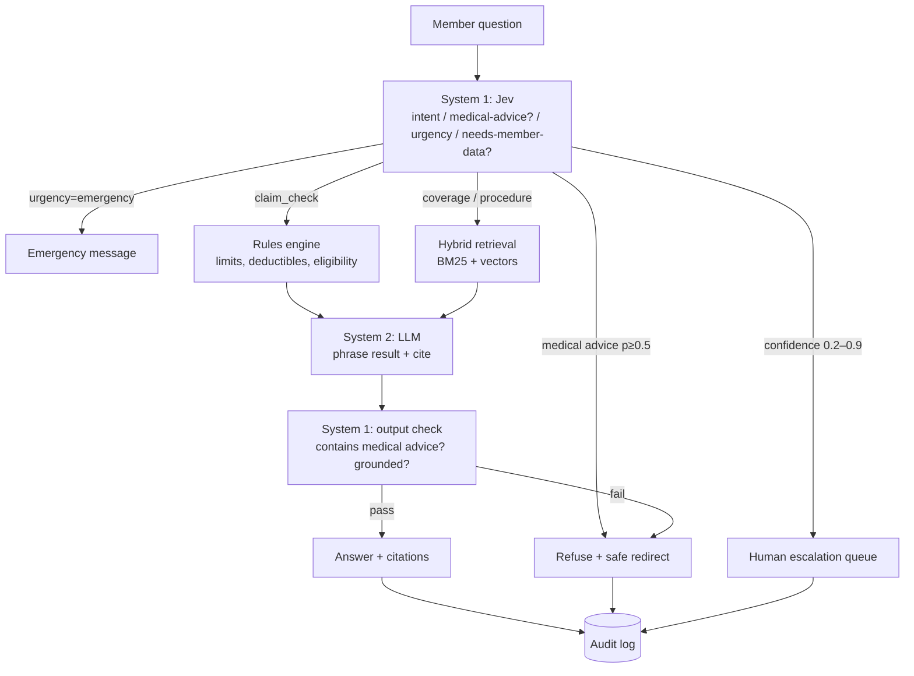

# BenefitPilot

An AI assistant for health-insurance plan members. It answers coverage and benefits questions with citations to plan sections, and flags plan-rule violations in claims.

> **Synthetic data only.** Every plan, member and claim in this repository is fictional. There is no real personal health information anywhere in the project.

> **Status:** Phase 5 (LangGraph pipeline, LLM client, output check, audit log, `/ask`). See [CLAUDE.md](CLAUDE.md) for the build plan and [docs/DECISIONS.md](docs/DECISIONS.md) for architecture decisions.

## Why System 1 / System 2

- **System 1, Jev (TypeSafe):** fast, calibrated typed judgments, used for routing, guardrails and urgency in one pass.
- **System 2, an LLM with retrieval:** slow and deliberate, and used only when a written, grounded answer is needed.
- **Deterministic code:** every dollar amount and limit check is done in plain Python, never by a model.



## Quick start

```bash
python -m venv .venv
.venv/Scripts/activate            # Windows; use source .venv/bin/activate on macOS/Linux
pip install -e ".[dev]"
cp .env.example .env              # works as is: ROUTER_BACKEND=fallback needs no keys
python scripts/generate_data.py   # writes data/benefitpilot.db (seeded, reproducible)
pytest
```

With Docker:

```bash
docker compose up --build         # API on http://localhost:8000/health
```

## Ask a question

```bash
curl -X POST localhost:8000/ask -H "Content-Type: application/json" \
  -d '{"member_id": "M021", "question": "I have used $420 of physio this year. Will a $120 session be covered?"}'
```

The response contains the answer, the route taken (`claim_check`, `coverage`, `procedure`, `emergency`, `refuse_medical`, `out_of_scope`, `escalate`), citations, the rules-engine result, the raw System 1 probabilities, any guardrails that fired, latency, cost and an `audit_id`. The full trace is at `GET /audit/{audit_id}`, and the human-review queue is at `GET /escalations`.

The safety routes (emergency, medical-advice refusal, out of scope, escalation) return fixed, reviewed text with no LLM call. Claim answers use dollar amounts from the rules engine only, and a guard replaces any LLM phrasing that changes a number or reverses the decision.

## Check a claim (rules engine only, no LLM)

```bash
uvicorn benefitpilot.api.app:app --reload
curl -X POST localhost:8000/claims/check -H "Content-Type: application/json" \
  -d '{"member_id": "M021", "category": "physiotherapy", "amount": "120", "date": "2026-10-15"}'
```

The response gives the outcome (`approve` / `partial` / `deny`), the covered amount, what the member pays, the violations, and every rule checked with its plan citation. For example: the plan share is $96.00, and the $500 annual maximum (with $420 already used) reduces it to $80.00, citing `PLAN-A §4.2.1`. Interactive docs are at `/docs`.

## Retrieval

Plan booklets are chunked one section per chunk, and the chunk ID *is* the citation (`PLAN-A §4.2.1`). Search combines BM25 and nomic-embed-text vectors with reciprocal-rank fusion. A cosine-based relevance gate decides whether the plan answers the question at all.

| Retrieval (48 questions) | hit@1 | hit@3 | Gate accuracy |
|---|---|---|---|
| BM25 only (offline/CI mode) | 0.70 | 0.86 | 0.69 |
| Hybrid with nomic-embed-text | 0.93 | 1.00 | 1.00 |

```bash
python scripts/eval_retrieval.py                 # with EMBEDDINGS_BACKEND=ollama in .env
python scripts/eval_retrieval.py --backend none  # BM25 only, offline
```

Details and caveats are in [ADR-015](docs/DECISIONS.md).

## Data

| Path | What it is |
|---|---|
| `data/plans/plan_a.md`, `plan_b.md` | Plan booklets (Bronze, Gold) with stable section IDs such as `PLAN-A §4.2.1` |
| `config/plans/plan_a.yaml`, `plan_b.yaml` | Machine-readable rules. A test keeps them in sync with the booklets |
| `scripts/generate_data.py` | Seeded generator: about 30 members plus dependents, YTD usage, and 100 claims with labeled violations |

---

<sub>BenefitPilot is a portfolio project. It uses synthetic data only and does not give medical advice.</sub>
